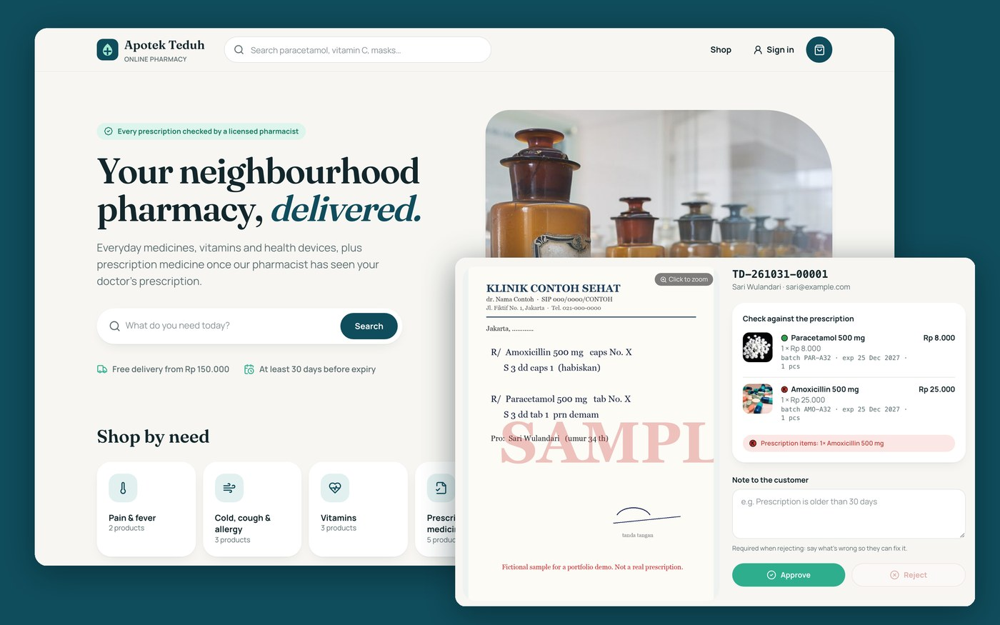
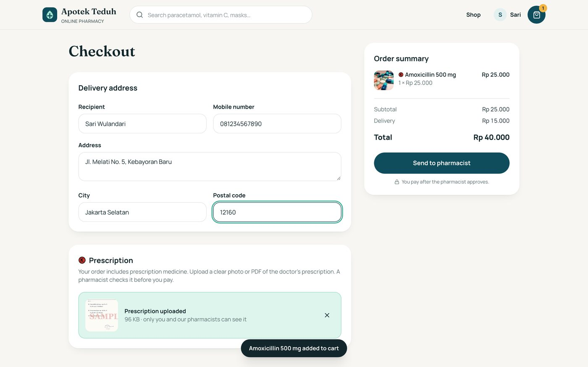
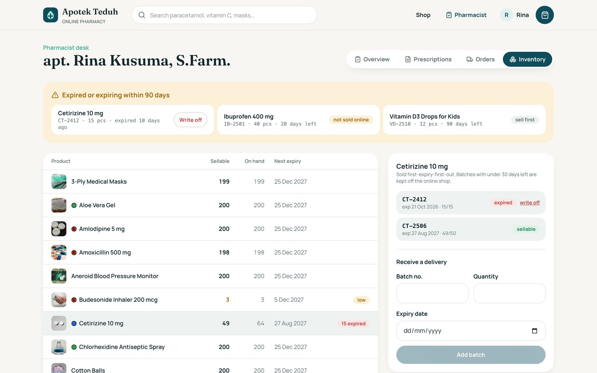

# Apotek Teduh: online pharmacy

[](https://github.com/dinulimann/apotek-online/actions/workflows/ci.yml)



An online pharmacy for **Apotek Teduh**, a fictional pharmacy in Jakarta. It has two sides:

- **Customers** browse medicines, vitamins and health products, order them, and upload a prescription for prescription-only medicine.
- **Pharmacists** check each prescription against the order before the customer can pay, ship paid orders, and manage stock by batch and expiry date.

Built with **Java 17** and **Spring Boot 4** (Spring MVC, Spring Security, JdbcClient, Flyway) on **PostgreSQL 17**, and **React 19**, **TypeScript** and **Tailwind CSS 4** for the web app. The backend is tested against a real database with **Testcontainers**, and the whole stack with **Playwright**.

## Pharmacy rules the backend enforces

- **Indonesian medicine classes.** Every product is *Obat Bebas* (over the counter), *Obat Bebas Terbatas* (limited quantity per order), *Obat Keras* (prescription only) or a health product. The shop shows the official green, blue and red marks.
- **Prescription medicine needs a pharmacist.** An order with *Obat Keras* needs an uploaded prescription that belongs to the customer. The prescription can serve only one active order. The order waits in `AWAITING_REVIEW` until a pharmacist approves it, and only then can it be paid. A rejection must give the customer a reason.
- **Stock is sold first-expiry-first-out.** Each order takes from the batch that expires first. Batches within 30 days of expiry are skipped, so customers never receive medicine that is about to expire. A line can span two batches. Each order records which batches it came from, and a rejection or cancellation returns the stock to those same batches.
- **The last units cannot be sold twice.** Batches are locked in a fixed order inside the order's transaction. In the tests, 30 customers race for the last 12 bottles: exactly 12 orders go through and stock ends at zero.
- **Every stock change goes into a ledger.** Receipts, sales, returns and write-offs are all recorded, and a test checks that each batch's quantity equals the sum of its ledger entries. Expired batches show up on a report and can be written off.
- **Retries are safe and unpaid orders expire.** Checkout takes an `Idempotency-Key`, so a retried request returns the first order. Orders that are not paid within 24 hours are cancelled by a scheduled job, and their stock is released.
- **Prescriptions are handled as sensitive files.** The file type is checked from the file's first bytes. An HTML page renamed to `.jpg` is refused, whatever the browser claims. Files are limited to 5 MB and stored outside the web root under random names. Only the patient and pharmacists can open them, served with `no-store`. Anyone else gets 404, so ids reveal nothing.
- **Sessions, CSRF and logins are protected.**
  - Session cookies are `HttpOnly`, `SameSite=Lax`, and get a new id at sign-in.
  - CSRF uses a double-submit token.
  - Failed logins are throttled.
  - The app sends a Content-Security-Policy.

## Tests

| Suite | What it covers | Tests |
|---|---|---|
| Spring Boot + Testcontainers (PostgreSQL) | catalogue and sellable stock, FEFO across batches, per-order caps, idempotent checkout, the prescription workflow, returning stock, payment expiry, the concurrency race, the stock ledger, file upload checks and access, inventory, login throttling, access control | 24 |
| Real HTTP with a cookie jar | sign up, sign out and sign in with the CSRF token, refused writes without it, security headers | 3 |
| Playwright (full stack) | search and filters, per-order cap, order and pay, prescription approved then paid, prescription rejected with a reason, ship and write off expired stock, sign-up and the pharmacist-only area | 7 |

CI runs `mvn verify` (tests start PostgreSQL in Docker), the Playwright suite against the built jar and web app, and a Docker build.

**Limits:**
- There is no payment gateway. The *Pay now (demo)* button stands in for the bank's confirmation.
- There is no live demo; run it with Docker as below.
- Login throttling is kept in memory, so it would need a shared store behind a load balancer.

## Run it

Requirements: Docker.

```bash
docker compose --profile app up -d --build
open http://localhost:8090
```

The app starts with demo data:
- Customer: **sari@example.com** / **demo1234**
- Pharmacist: **apoteker@teduh.example** / **apoteker123**
- One order is waiting for prescription review, using a sample prescription clearly marked as fictional.

Developing without the app container (Java 17, Maven, Node 22):

```bash
docker compose up -d db
cd backend && mvn spring-boot:run -Dspring-boot.run.profiles=demo   # API on :8080
cd frontend && npm ci && npm run dev                                  # http://localhost:5173
```

Tests: `mvn verify` in `backend/` (needs Docker), and `npm run test:e2e` in `frontend/`. The end-to-end tests need the jar from `mvn package` and a database named `apotek_e2e` (`E2E_DATABASE_URL`), which they wipe.

## Structure

```
backend/src/main/java/.../catalog        products, categories, sellable stock
backend/src/main/java/.../inventory      batches, FEFO allocation, ledger, expiry report
backend/src/main/java/.../orders         order lifecycle, pharmacist review, payment expiry
backend/src/main/java/.../prescriptions  upload checks and private file serving
backend/src/main/java/.../auth           accounts, sessions, login throttling
backend/src/main/resources/db/migration  schema and sample catalogue (Flyway)
frontend/src/pages                       shop, product, checkout, orders, pharmacist desk
frontend/tests                           Playwright tests
```

| Checkout with a prescription | Pharmacist's stock by batch |
|---|---|
|  |  |

## About the photos

The product photos are illustrations from Wikimedia Commons under CC0 and Creative Commons licences. They do not show the products they are next to. Each one is credited in [CREDITS.md](CREDITS.md). Products use generic names, not real brands. Apotek Teduh is not a real pharmacy: no medicine is sold and no money moves. Built by Dinul Iman.
